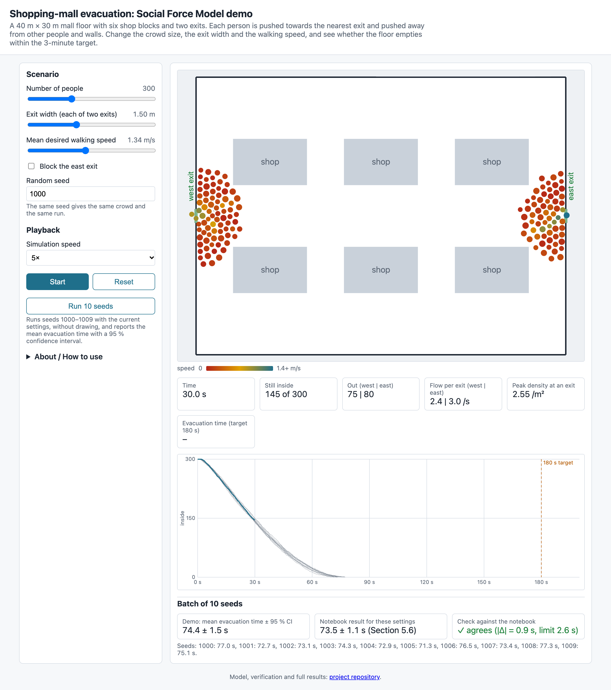
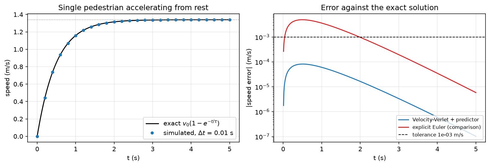
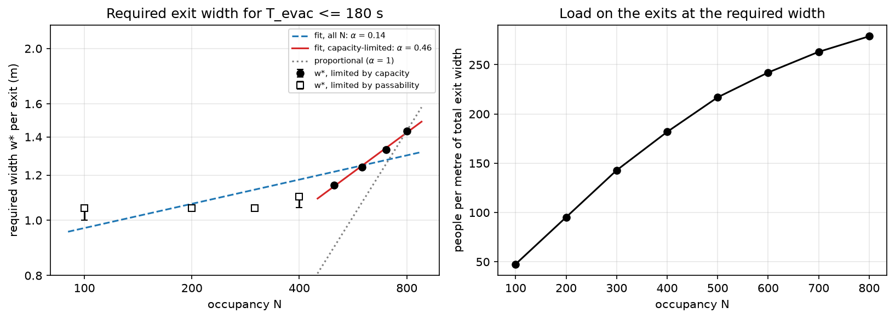

# Shopping-Mall Evacuation: How Exit Width Must Scale with Crowd Size

A Social Force Model simulation of people evacuating a shopping-mall floor, used to find how wide the exits must be to empty the floor within three minutes as the number of occupants grows.

**[Live demo](https://chanurasmika.github.io/mall-evacuation-social-force/)** · [](https://colab.research.google.com/drive/1wRo2CGOUVnhi8o63iRlRsOa9wsoePZ47?usp=sharing)



## The problem

Large shopping malls hold hundreds of shoppers on one open floor. In an emergency everyone heads for a few exits at once, and the doorways become bottlenecks: the floor can only empty as fast as people can get through them. If the exits are too narrow for the number of people inside, queues build up and evacuation takes far longer than the walking distance suggests.

This project asks: **how wide must the two exits of a 40 m × 30 m mall floor be for everyone to get out within 180 seconds, as occupancy rises from 100 to 800 people? And does the exit width have to grow faster than the number of occupants?** Exit width and maximum safe occupancy are linked design decisions, so the answer shows whether a floor can safely hold more people and how much wider its exits would need to be.

## Quick start

**Notebook:** click the *Open in Colab* badge above, then *Runtime → Run all*. Missing packages are installed automatically. The large parameter sweeps are loaded from the cached results in [`data/`](data/README.md) and spot-checked by re-simulation, so a full run takes about 4 minutes on a laptop (allow somewhat longer on a free Colab runtime). Set `QUICK_MODE = False` in the first code cell to regenerate every result from scratch (about 35 minutes on 10 cores).

**Web demo:** open the [live demo](https://chanurasmika.github.io/mall-evacuation-social-force/), or download this repository and double-click `docs/index.html`. It runs entirely in the browser.

**Run locally (optional):**

```bash
pip install -r requirements.txt
jupyter notebook notebook/mall-evacuation-social-force.ipynb
```

## Using the demo

Choose the number of people (50–800), the width of each exit, the mean walking speed and whether the east exit is blocked, then press **Start** and watch the crowd queue at the exits, coloured by speed. The panel below shows the elapsed time, people out through each exit, the flow per exit, the peak density and the final evacuation time against the 180 s target. **Run 10 seeds** repeats the scenario with ten random crowds and compares the mean with the notebook's result for the same settings. Full guide: [USER_GUIDE.md](USER_GUIDE.md).

## Model and mathematics

Each person $i$ is a disc of radius $r_i$ with their own desired walking speed $v_i^0$, moving under Newton's second law with the Social Force Model [1], [2]:

$$
m_i \frac{d\mathbf{v}_i}{dt} = m_i\,\frac{v_i^0\,\mathbf{e}_i^0 - \mathbf{v}_i}{\tau} + \sum_{j \ne i} \mathbf{f}_{ij} + \sum_{W} \mathbf{f}_{iW}.
$$

The first term drives each person towards their desired velocity along $\mathbf{e}_i^0 = -\nabla D / \lVert \nabla D \rVert$, where $D$ is the walking distance to the nearest exit, computed with the fast marching method so that people route around the shop blocks. The pair and wall forces combine an exponential repulsion with body compression and sliding friction when bodies touch. The equations are integrated with **Velocity-Verlet with a velocity predictor** (second order, one force evaluation per step) at $\Delta t$ = 0.005 s (0.0025 s above 400 people), a step chosen from the scheme's stability limits, and neighbours are found with **cell lists** so a step costs $O(N)$. Every scenario is repeated over 20 random crowds and reported with t-based 95 % confidence intervals. Derivations, assumptions, parameters and the stability analysis: [THEORY.md](THEORY.md).

## Verification

- **Analytic check:** one person in open space follows $v(t) = v_0(1 - e^{-t/\tau})$ with a maximum error of $2.1 \times 10^{-5}$ m/s, as predicted for the scheme; a first-order Euler control fails the same test.
- **Error scaling:** the integrator error falls as $\Delta t^{2.00}$ and the Monte Carlo standard error as $R^{-0.50}$ on log–log plots.
- **Built-in checks:** people are conserved and nobody passes through a wall at every step of every run; cell-list forces equal the brute-force sum to $10^{-11}$; too-large time steps are shown to fail.
- **Plausibility:** the simulated flow through exits of 1.0–1.2 m (1.34–1.60 people per metre per second) lies between the design value of 1.3 and published bottleneck experiments [7], [8].
- **Web demo:** its JavaScript model reproduces the notebook's distance map exactly and its evacuation times statistically in six test cases.



## Concepts applied

This project applies particle-based simulation of interacting agents with short-range pair forces, numerical integration of Newton's equations of motion with a second-order explicit scheme together with its stability analysis and convergence order, cell-list neighbour search, shortest-path computation by solving the eikonal equation with the fast marching method, random variate generation by rejection sampling and inverse transform, and Monte Carlo replications with t-based confidence intervals, common random numbers and bootstrap resampling based on the law of large numbers. It verifies the simulator against an analytic relaxation solution, conservation checks, time-step convergence and published bottleneck-flow measurements.

## Results

| People $N$ | 100 | 200 | 300 | 400 | 500 | 600 | 700 | 800 |
|---|---|---|---|---|---|---|---|---|
| Required width per exit $w^*$ (m) | 1.05 | 1.05 | 1.05 | 1.10 | 1.15 | 1.24 | 1.33 | 1.44 |
| Limited by | passability | passability | passability | passability | capacity | capacity | capacity | capacity |

- **Up to about 400 people** each exit must be about 1.05–1.10 m wide. That minimum is set by whether everyone can get through the door at all, not by the time target.
- **From 500 to 800 people** the 180 s target decides, and the required width grows like $N^{0.46}$ (95 % CI 0.45–0.48), roughly $\sqrt{N}$: **more slowly than occupancy, not faster.** Because the model's flow per metre grows with width more than in experiments, this exponent is a lower bound.
- **With one exit blocked**, evacuation takes 1.5–1.7 times as long; 300 people then need about 1.25 m instead of 1.05 m.
- **The walking speed of the crowd matters most:** a calmer crowd at 1.0 m/s takes 68 s longer at 600 people and misses the target.



## Limitations and future work

- **Model parameters are from the literature, not local crowds.** The answer is far more sensitive to the walking speed and reaction time than to Monte Carlo error; calibrating them to observed evacuations would matter most.
- **The model under-predicts flow through narrow exits** compared with experiments, so exits below about 1.0 m may never clear in the model and the scaling exponent is a lower bound.
- **Everyone starts at once and uses the nearest exit:** no reaction time, no re-routing to a less crowded exit. Adding both, and a real floor plan, would be the next steps.

## Key references

1. D. Helbing and P. Molnár, "Social force model for pedestrian dynamics," *Phys. Rev. E*, vol. 51, no. 5, pp. 4282–4286, 1995, doi: [10.1103/PhysRevE.51.4282](https://doi.org/10.1103/PhysRevE.51.4282).
2. D. Helbing, I. Farkas and T. Vicsek, "Simulating dynamical features of escape panic," *Nature*, vol. 407, no. 6803, pp. 487–490, 2000, doi: [10.1038/35035023](https://doi.org/10.1038/35035023).
7. A. Seyfried, O. Passon, B. Steffen, M. Boltes, T. Rupprecht and W. Klingsch, "New insights into pedestrian flow through bottlenecks," *Transp. Sci.*, vol. 43, no. 3, pp. 395–406, 2009, doi: [10.1287/trsc.1090.0263](https://doi.org/10.1287/trsc.1090.0263).
8. T. Kretz, A. Grünebohm and M. Schreckenberg, "Experimental study of pedestrian flow through a bottleneck," *J. Stat. Mech.*, vol. 2006, no. 10, Art. no. P10014, 2006, doi: [10.1088/1742-5468/2006/10/P10014](https://doi.org/10.1088/1742-5468/2006/10/P10014).

Full list: [REFERENCES.md](REFERENCES.md).

## AI assistance

Developed with the help of AI coding and writing assistants. All code was reviewed, run and verified by the author.

## Licence and credits

Code: [MIT](LICENSE). Data: no external datasets are used. All inputs are synthetic; model parameters come from [1] and [2], and the bottleneck-flow values used for the plausibility check are quoted from [7] and [8] with citation (see [data/README.md](data/README.md)).
