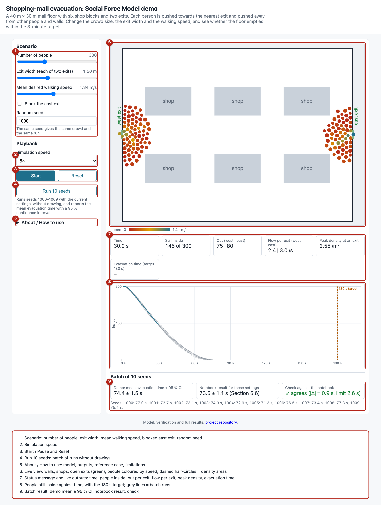

# User guide: mall evacuation web demo

**Open the demo:** <https://chanurasmika.github.io/mall-evacuation-social-force/>. It runs entirely in your browser (current Chrome, Edge or Firefox); nothing is installed or uploaded. To use it offline, download the repository and double-click `docs/index.html` (keep `model.js`, `script.js` and `style.css` next to it).

The demo runs the same model as the notebook, ported to JavaScript: a 40 m × 30 m mall floor with six shop blocks and an exit in the middle of the west and east walls. Each person walks along the shortest route to the nearest open exit and is pushed away from other people and from walls.

## Controls

| # | Control | What it does | Range | Default |
|---|---|---|---|---|
| 1 | Number of people | Crowd size, placed at random on the free floor | 50–800 | 100 |
| 1 | Exit width | Width of **each** of the two exits | 0.6–3.0 m | 1.5 m |
| 1 | Mean desired walking speed | Average speed people want to walk at (each person's own speed varies with s.d. 0.26 m/s) | 0.8–2.0 m/s | 1.34 m/s |
| 1 | Block the east exit | Closes the east exit with a wall; everyone must use the west exit | on / off | off |
| 1 | Random seed | Chooses the random crowd; the same seed always gives the same run | any whole number | 1000 |
| 2 | Simulation speed | How fast the clock runs compared with real time | 1× to as fast as possible | 5× |
| 3 | Start / Pause, Reset | Runs or pauses the simulation; Reset starts again with the current settings. Changing any setting also resets | — | — |
| 4 | Run 10 seeds | Runs the current settings with seeds *seed* to *seed* + 9, without drawing, and reports the mean evacuation time | — | — |
| 5 | About / How to use | Short description of the model, the outputs and the limitations; also shows the result of a self-test run when the page loads | — | — |

## Reading the outputs

- **Live view (6):** shops are grey, open exits green and a blocked exit red. People are drawn at their real size and coloured by their current speed: red means stopped or squeezed, blue means walking freely. The dashed half-circles mark the 2 m areas where the density at each exit is measured.
- **Live outputs (7):** elapsed simulated time; people still inside; people out through the west | east exit; **flow per exit**, the number of people per second who left through each exit over the last 5 s; the **peak density** in front of an exit (people per m²; above about 2 the queue is tightly packed); and the **evacuation time** when the last person is out, with ✓ if it is within the 180 s target. When the run ends, a message also gives the time for 90 % to get out and the specific flow (people per metre of exit width per second).
- **Chart (8):** people still inside against time, with the 180 s target as a dashed line. After a batch, the ten runs are drawn in grey.
- **Batch (9):** the mean evacuation time of the ten runs with its 95 % confidence interval. If the settings match a case simulated in the notebook, the notebook's result (20 runs) is shown next to it with a check.

## Try this

1. Press **Start** with the default settings. Queues form at both exits, and the floor empties in about 38 s.
2. Tick **Block the east exit** and press **Start**. Everyone, including people standing next to the east exit, turns and walks to the west exit. Evacuation takes about 1.5 times as long, and the peak density at the west exit rises.
3. Set 600 people and an exit width of 1.25 m, and press **Run 10 seeds**: the mean is close to 180 s. Now lower the walking speed to 1.00 m/s and run the batch again. The floor takes about a minute longer: a calm, slow crowd needs wider exits.
4. Set the exit width to 0.80 m. The page warns that narrow exits may never clear. Run it and watch the last few slow people stop at the door edges.

## Check against the notebook

With the default settings (100 people, 1.5 m exits, 1.34 m/s, both exits open), **Run 10 seeds** gives **38.0 ± 1.4 s**. The notebook's result for the same case is **38.8 ± 0.9 s** (Section 5.6, 20 seeds), and the check shows **✓ agrees**. The demo uses its own random number generator, so single runs differ from the notebook's; the check passes if the two means differ by less than the two confidence half-widths added together. The demo knows the notebook's result for 52 combinations of crowd size, exit width, blocked exit and walking speed. On every page load it also checks one person walking in open space against the exact speed curve, as the notebook does.

## Limitations

- Exits narrower than about 1.0 m may never clear: in this model the slowest people stop at the door edges once nobody is pushing from behind, so results there are not reliable.
- Everyone starts moving at the same moment (no reaction time) and goes to the nearest exit, even if it is crowded.
- Model parameters come from the published Social Force Model literature, not from measurements of local crowds.
- Large crowds are slow to simulate: a batch of 10 runs with 800 people takes several minutes, and the live view runs at only a few times real time.
